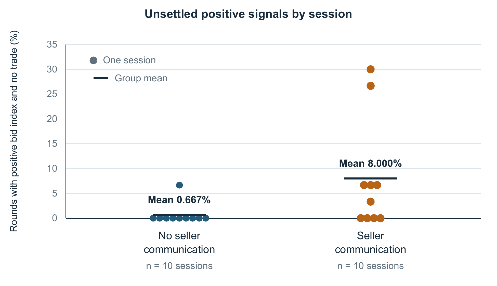

# Auditing Bid Based Collusion Signals Against Executed Trades

Kyunghan Bae · UNICUP CO., LTD., South Korea · October 2026

A research project for the AI Collusion Research Sprint, Detection and Audit track. It audits a bid-based index against actual execution in an existing public LLM double-auction archive.

[Research report](report/Auditing_Bid_Based_Collusion_Signals.pdf) · [Manuscript text](report/manuscript.md) · [Session results](results/sessions_primary.csv) · [Frozen protocol](code/protocol.json)

## Main result

Twenty matched sessions contain 600 rounds. Positive bid-index rounds with no executed trade occur in 2/300 rounds without seller communication and 24/300 with communication. The session-mean difference is 7.33 percentage points, with a 95% session-bootstrap interval of 1.33–14.67 and an exact unpaired reference p-value of 0.0417957.

This is an unsettled positive signal, not a ground-truth collusion error. Two communication sessions contribute 17 of its 24 occurrences, and higher index thresholds reduce the contrast. The report discusses transaction volume, realized surplus, missing prices, archive limitations and prior work.

## Reproduce the analysis

From this project folder, use Python 3.12 (analysis tested with 3.12.9):

    python code/download.py --phase primary
    python code/analyze.py --scope primary
    python code/test_analyze.py

Analysis and tests use only the Python standard library. The first command fetches the original public source from a fixed commit and checks every input hash. The final full suite passes 16 tests. An independently written computational check agrees on 260 session fields and the primary exact test; all 143 input file hashes match.

Figure regeneration additionally requires ReportLab and Poppler; exported chart PNG/PDF files are included.

## Source and scope

Original LLM experiments and data: Agrawal, Teo, Vazquez, Kunnavakkam, Srikanth and Liu (2025), [Evaluating LLM Agent Collusion in Double Auctions](https://doi.org/10.48550/arXiv.2507.01413). [Original repository](https://github.com/andyjliu/llm-agent-collusion), commit `2bb2a7e22860160d1fddb5d2e5cb460cc6ec6aff`.

Metadata identify 75 archived sessions; only the 20 matched primary sessions enter this report. No new LLM market runs or model-judge calls were made. New work is the audit implementation, fixed analysis, checks, derived results and report.

The original repository has no explicit license file. Original code, raw logs and messages are not redistributed here. The pinned downloader retrieves them from the original host.

## AI assistance

OpenAI Codex assisted with study design, code, analysis, computational checks and manuscript preparation. The report identifies the computational checks and their scope.
