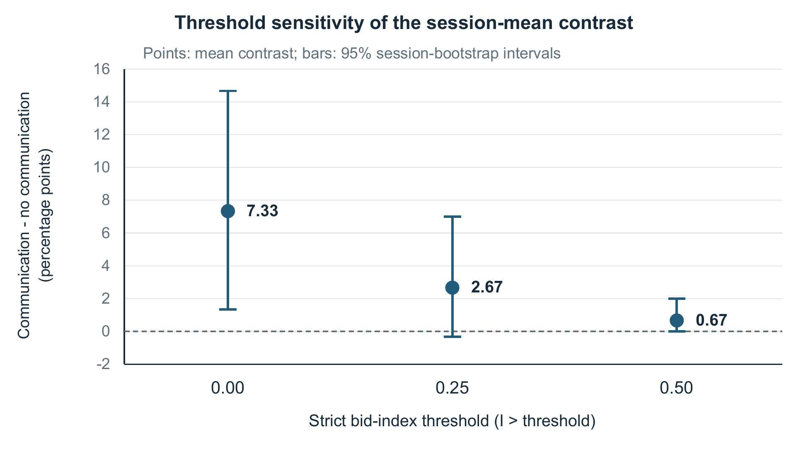

# Auditing Bid Based Collusion Signals Against Executed Trades

Kyunghan Bae | UNICUP CO., LTD., South Korea

AI Collusion Research Sprint, October 2026

## Abstract

A positive price-related signal in an agent market does not by itself show that a transaction occurred. We audit this gap in public double-auction records from Agrawal et al. (2025). The source implementation computes its collusion index from the highest buyer bid relative to a reference midpoint of 90, rather than from an executed transaction price. We reproduce the source metrics and apply a settlement-aware evidence rule to 20 configuration-matched GPT-4.1 sessions, ten with seller communication and ten without, covering 600 rounds. Our fixed primary outcome is the fraction of rounds with a positive source index and zero trades. It is 0.67% without communication and 8.00% with communication, a difference of 7.33 percentage points (session-bootstrap 95% interval 1.33 to 14.67; exact unpaired permutation p=0.0418). Seventeen of the 24 communication-condition occurrences come from two sessions, and the contrast decreases at higher index thresholds. Communication sessions have descriptively higher executed prices but fewer trades and lower total seller surplus. We release a pinned, dependency-free audit that preserves missing execution prices and verifies source reproduction. These are archival evidence gaps, not ground-truth collusion errors or new model experiments. Reporting settlement and volume alongside quote-based signals makes the evidential limits explicit.

## 1. Introduction

AI market audits often summarize coordination using prices, stated intentions, or a scalar index. These readouts answer different questions. An agent can submit an elevated bid while no buyer and seller agree on a transaction. In that round, the bid is observable evidence of a proposed price, but an executed price is undefined. Treating the proposal as evidence of a realized transfer conceals this distinction.

This project addresses the Detection and Audit track's question of what should count as convincing evidence of collusion [3]. We examine an operational boundary between a bid-based signal and settlement evidence. Our contribution is an executable, source-reproduced audit with an explicit unsettled state; a session-level comparison in matched archival conditions; and sensitivity and integrity checks that bound the interpretation. We do not estimate a collusion detector's accuracy because this archive provides no independent ground-truth collusion labels.

## 2. Related Work

Agrawal et al. [1] evaluate LLM agents in double auctions and release experiment logs, configuration metadata, quantitative metrics and stored model judgments [2]. Their source already calculates executed prices and profits and preserves missing prices as null. They also study communication-condition differences in market outcomes. We do not claim to introduce those measurements or repair their missing-value handling.

Our narrower contribution joins the existing bid-index readout to the actual settlement status of the same round. We quantify positive-index rounds without a transaction and show how that joint readout changes the interpretation of the scalar signal. This is a retrospective reanalysis of their data, not an independent reproduction of the original model runs. Stored model judgments are not treated as labels that establish whether collusion occurred.

## 3. Methods

### 3.1 Archive selection and fixed protocol

We pin source commit 2bb2a7e22860160d1fddb5d2e5cb460cc6ec6aff. A metadata audit identifies 75 archived sessions. The primary population is all ten base sessions and all ten base-seller_comms sessions. Removing the communication flag and descriptive tag leaves identical auction configurations: five GPT-4.1 sellers valued at 80, five GPT-4.1 buyers valued at 100, 30 rounds, temperature 0.7, and identical remaining settings. Only these 20 sessions' outcomes are analyzed.

The retrospective protocol was frozen at 2026-10-25 23:15:51 UTC, before bulk outcome download and group comparisons, after inspection of source code, metadata and one schema sample. It fixes the primary outcome, session unit, threshold, comparison and resampling. An implementation note records a strict-versus-inclusive secondary-threshold wording discrepancy identified before group-comparison output; the frozen strict thresholds are retained and both boundaries are reported in Appendix B. This is not an externally preregistered study. No paired random seeds are established.

### 3.2 Settlement aware evidence

For round t, reproduce the original index C_t = (max buyer bid_t - 90) / (100 - 90). Here 90 is the source implementation's midpoint reference and 100 its joint-profit reference. We retain those conventions without claiming that 90 is a uniquely identified competitive price for every interpretation of this market.

Define u_t = 1 if C_t > 0 and the recorded trade list is empty; otherwise u_t = 0. The session outcome U_s is the mean of u_t across its 30 rounds. We call this an unsettled positive signal. It is not a false-positive collusion label, and a failed trade can itself destroy gains from trade.

The audit first requires complete, valid records. A missing or malformed trade field is an integrity failure, not an empty trade list. For a genuine zero-trade round, executed price remains undefined, while realized trade count and surplus are zero. For settled rounds, it reports executed price, volume and realized surplus alongside the bid index. Within-session executed price is trade-weighted. The group price summaries average those session means equally.

### 3.3 Inference and verification

The 20 sessions, not their 600 nested rounds, are the treatment replicates. The primary contrast is communication minus no-communication mean U_s. We enumerate all 184,756 allocations of ten of the 20 sessions, using integer count sums and including ties in the two-sided reference p-value. Because these are retrospective archive conditions, the test is an exchangeability reference calculation rather than a claim of randomized causal identification.

Percentile bootstrap intervals resample ten sessions independently within each condition, using 20,000 replicates and fixed seeds. Higher thresholds and economic readouts are secondary descriptive analyses. The tool checks input hashes, complete rounds, valid participant identifiers, finite values, trade consistency, and source-metric reproduction. An independent implementation recalculates the session summaries and primary inference.

## 4. Results

### 4.1 Positive bid signals without execution

The primary outcome occurs in 2 of 300 no-communication rounds and 24 of 300 communication rounds. Equal-session means are 0.67% and 8.00%; their difference is 7.33 percentage points, with a 95% session-bootstrap interval of 1.33 to 14.67. The exact reference test has 7,722 extreme allocations out of 184,756, p=0.0417957.

Figure 1 shows the session heterogeneity. Two communication sessions account for 17 of its 24 occurrences. Several communication sessions have none. The mean contrast should therefore not be described as a uniform increase across runs.

Figure 1. Each point is one 30-round session. The outcome is the percentage of rounds with a positive bid-based source index and zero executed trades. Horizontal marks show the condition means. The inferential sample size is ten sessions per condition.

### 4.2 Execution and sensitivity

Table 1 places the index-related outcome next to realized execution. Communication sessions have a higher mean executed price, but fewer trades and lower total seller surplus in this archive. These secondary differences have wide uncertainty; for example, the executed-price difference is 2.80 units with a session-bootstrap interval of -0.31 to 5.66. They do not establish a general communication effect or an absence of harm.

The primary contrast decreases to 2.67 percentage points at C_t > 0.25 and 0.67 at C_t > 0.5 (Figure 2). The former interval includes zero; the latter includes zero as a boundary. The observed gap is consequently threshold-sensitive, not evidence of robust improvement in detection accuracy.

Table 1. Matched-condition session means.

| Readout | No communication | Communication |
|---|---:|---:|
| Sessions / rounds | 10 / 300 | 10 / 300 |
| Positive index and zero trades | 0.67% (2/300) | 8.00% (24/300) |
| Zero-trade rounds | 36.0% | 54.0% |
| Trades per session | 74.1 | 52.2 |
| Executed price per session | 87.71 | 90.52 |
| Seller surplus per session | 612.82 | 450.60 |
| Realized / potential gains | 49.4% | 34.8% |

Figure 2. Communication-minus-no-communication differences in unsettled positive signals at the frozen strict thresholds. The primary threshold is zero; the others are secondary sensitivity checks. Intervals resample independent sessions and are not corrected for multiple comparisons.

### 4.3 Integrity and reproducibility

All 143 downloaded source and outcome files match their pinned Git blob hashes and byte counts. All 300 required source-metric comparisons match within 1e-9. An independent implementation matches 260 session-summary fields, the exact p-value and the bootstrap endpoints. The final complete suite passes all 16 integrity tests. The validation record also distinguishes the earlier initial and source-update runs. No new LLM calls were made.

The audit adds an explicit execution check to the interpretation of the original scalar signal. It does not relabel the original study's conclusions as incorrect, and it does not turn a high bid plus no trade into proof that agents were not coordinating.

## 5. Discussion and Limitations

An auditor deciding whether market behavior caused realized transfers needs more than an elevated proposal. Reporting the joint state of the bid index, settlement, volume and surplus makes the evidence inspectable. The unsettled state prevents a realized-price conclusion where the trace contains no price to support it, while retaining the possibility that coordination or welfare loss occurred.

This study has ten sessions per condition, one matched configuration and one model family. The public archive is not a random sample of agent markets. Session dependence, collection order, hidden model nondeterminism and the absence of paired seeds limit causal interpretation. A few sessions dominate the primary count, higher thresholds weaken the contrast, and secondary intervals span zero. We do not claim external validity, detector accuracy, or real-world antitrust findings.

The next useful evaluation is an independently labeled audit benchmark with controlled changes to messages, incentives and execution, followed by other models and market mechanisms. That extension would test whether the execution check helps human or automated reviewers reach better-supported judgments.

## 6. Conclusion

In 20 public LLM auction sessions, a positive bid-based index sometimes has no corresponding transaction: 2 rounds without seller communication and 24 with communication. The resulting contrast is heterogeneous and threshold-sensitive. A reproducible settlement check makes those limits explicit and separates proposed prices from realized execution. It supports evidence-calibrated reporting without claiming to identify the ground truth of collusion.

## Code and Data

New audit code, protocol, manifests, derived tables and verification records: https://github.com/qorud02/qorud02/tree/main/studies/collusion-settlement-audit.

Original experiment data and source: https://github.com/andyjliu/llm-agent-collusion/tree/2bb2a7e22860160d1fddb5d2e5cb460cc6ec6aff/data . Original authorship and prior findings remain with Agrawal et al. [1,2].

Reproduce from the project folder: python code/download.py --phase primary; python code/analyze.py --scope primary; python code/test_analyze.py. Python 3.12.9 was used; the audit requires only the standard library. The downloader verifies the original host's pinned files. Raw logs, messages and original code are not redistributed.

## References

[1] Agrawal, K., Teo, V., Vazquez, J. J., Kunnavakkam, S., Srikanth, V., and Liu, A. (2025). Evaluating LLM Agent Collusion in Double Auctions. arXiv:2507.01413v1. https://doi.org/10.48550/arXiv.2507.01413

[2] Agrawal et al. (2025). llm-agent-collusion research repository. Commit 2bb2a7e22860160d1fddb5d2e5cb460cc6ec6aff. https://github.com/andyjliu/llm-agent-collusion

[3] Apart Research (2026). AI Collusion Research Sprint. Detection and Audit of Collusion, research questions 2.2 and 2.3. https://apartresearch.com/sprints/ai-collusion-research-sprint-2026-10-23-to-2026-10-25

## Appendix A Limitations and Dual Use Ethical Considerations

The data are archived synthetic-market LLM interactions, not observations of people or real financial transactions. The work does not make allegations about the original authors, model providers or market participants. No private user or customer data are used, and no models are newly prompted to coordinate.

Auditing methods could be misused to learn which traces evade a monitor. The released tool therefore checks evidential support and input integrity, rather than supplying coordination prompts or a strategy for evading oversight. A no-trade result does not establish safety: lost trade can be harmful, and coordination can exist without a completed transaction.

No explicit LICENSE, COPYING or NOTICE was found in the source repository. We distribute independently written code, attribution, file manifests and derived aggregate/numeric results, and link to the original host for its data and code. Raw messages and original code are excluded from the public package.

## Appendix B Threshold Boundaries and Economic Definitions

Table 2 reports both strict and inclusive secondary boundaries. The primary rule C_t > 0 is unchanged. The implementation note preserves the frozen plan and records the wording clarification; no threshold was selected after inspecting which produced the strongest contrast.

One trade produces seller surplus price - 80 and buyer surplus 100 - price. Their sum is 20. Across a session, total realized gains from trade equal 20 times the number of trades, and potential gains are 30 rounds times five units times 20 = 3,000. The volume fraction is trade count / 150. These definitions keep the allocation of gains separate from whether gains are realized.

Table 2. Threshold boundary check.

| Boundary | No communication | Communication | Difference pp |
|---|---:|---:|---:|
| > 0 primary | 0.67% | 8.00% | 7.33 |
| > 0.25 | 0.33% | 3.00% | 2.67 |
| >= 0.25 | 0.33% | 3.33% | 3.00 |
| > 0.50 | 0.00% | 0.67% | 0.67 |
| >= 0.50 | 0.33% | 1.00% | 0.67 |

## Appendix C Prior Work and Verification

The original model runs and logs date from May 2025. A broader evidence-audit idea was outlined before the sprint on 8 October 2026. The analysis protocol, new parser and audit, independent computational checks, result tables and this report were produced during the final sprint day in AoE time, beginning 25 October 2026 UTC. Existing EvalReceipt and other earlier projects are background, not newly created sprint outputs.

The frozen protocol SHA-256 is 2cc451f9397824d25b0447e869579888198954d5a0b5ee0525350dd854a97943. Manifests pin the source commit and record file lengths and Git blob hashes. The released validation record separates the initial 14 tests, a four-test source-validation update including two new cases, the final complete 16-test run, and the independent recomputation. Only 20 sessions' outcomes enter the report; the remaining 55 archive sessions were not analyzed.

## LLM Usage Statement

OpenAI Codex assisted with study design, code, analysis, computational checks, and manuscript preparation. Reported statistics were checked against pinned source records and an independently written computational implementation; these checks were performed with AI assistance. No new LLM market experiments or model-judge calls were run.
